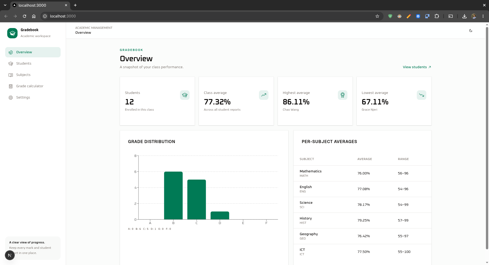
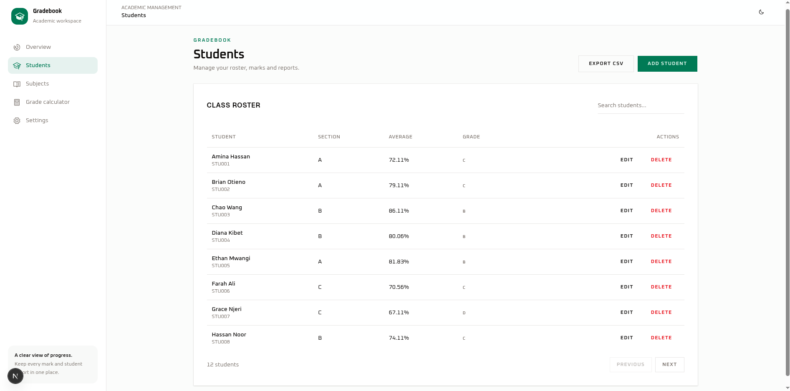
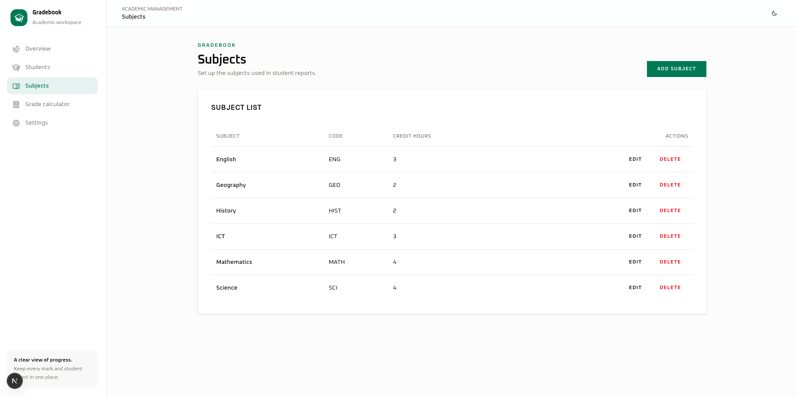
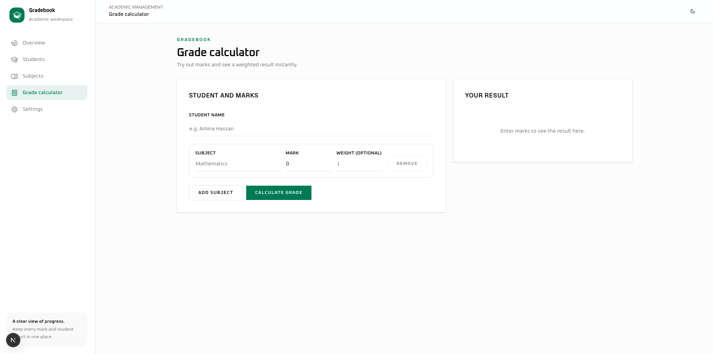
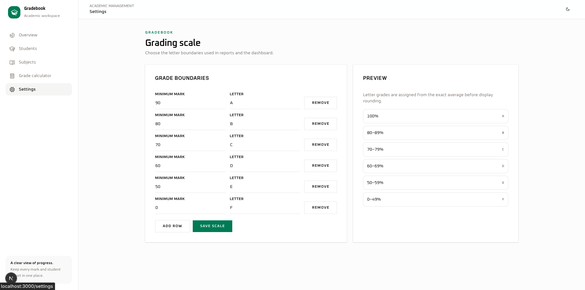

# Student Grade Management System

A full-stack grade management application: a Next.js interface backed by an Elixir (Phoenix) JSON API. It grew out of a command-line assignment for Software Quality and Improvement and keeps the same grading rules, now with weighted subjects, a configurable grading scale, class statistics and CSV export. The original command-line version is kept in `cli-version/`.

## Screenshots

| Overview | Students | Subjects |
|---|---|---|
|  |  |  |

| Grade calculator | Settings |
|---|---|
|  |  |

## Features

- Dashboard with class average, highest and lowest students, grade distribution chart and per-subject averages
- Student list with search, sorting, pagination, add, edit, delete and CSV export
- Student report with editable marks, weighted total and average, letter grade and class rank
- Subject management with credit hours used as weights
- Grade calculator that stores nothing (the original command-line behaviour), with an option to save the result as a student
- Configurable grading scale with validation and preview
- Mock mode, so the interface runs without the backend
- Clear validation messages, with server errors shown next to the matching form fields

## Grading rules

- Marks are numbers from 0 to 100 inclusive. Empty names, non-numeric marks and out-of-range marks are rejected.
- Average = sum(mark x weight) / sum(weight), where weight is the subject's credit hours (default 1). With equal weights this is the plain arithmetic mean.
- A student needs at least one mark to get a result.
- The letter grade is decided from the unrounded average. The displayed average is rounded to two decimals.

| Average | Grade |
|---|---|
| 90 and above | A |
| 80 - 89.99 | B |
| 70 - 79.99 | C |
| 60 - 69.99 | D |
| 50 - 59.99 | E |
| Below 50 | F |

The scale is stored in the database and can be changed on the settings page. It must be sorted from highest to lowest and end with a minimum of 0.

## Tech stack

- **Frontend:** Next.js 16, React 19, TypeScript, Tailwind CSS 4, shadcn/ui, TanStack Query, react-hook-form, zod, Recharts, Vitest, ESLint
- **Backend:** Elixir, Phoenix 1.8 (API only), Ecto, SQLite (ecto_sqlite3), Bandit, ExUnit

## Project structure

```
backend/        Elixir Phoenix API (port 4000)
next-app/       Next.js frontend (port 3000)
cli-version/    Original command-line version and its report
docs/           Screenshots
```

How the backend is organised:

- `GradeApi.Grading`: pure grading rules (mark validation, weighted average, letter lookup, result summary)
- `Students`, `Subjects`, `Grades`, `Scale`, `Reports`: data access, class statistics, ranking and CSV export
- `GradeApiWeb`: router, controller, error responses and the CORS plug

## Getting started

Requirements: Elixir with Erlang/OTP, and Bun.

**Backend**

```bash
cd backend
mix setup
mix phx.server
```

The API runs at http://localhost:4000/api/v1. Check it with `curl http://localhost:4000/api/v1/health`.

**Frontend with mock data (no backend needed)**

```bash
cd next-app
bun install
NEXT_PUBLIC_USE_MOCKS=true bun run dev
```

**Frontend against the real API**

```bash
cd next-app
NEXT_PUBLIC_USE_MOCKS=false NEXT_PUBLIC_API_URL=http://localhost:4000/api/v1 bun run dev
```

Open http://localhost:3000.

## API overview

Base URL: `http://localhost:4000/api/v1`

| Method and path | Purpose |
|---|---|
| `GET /health` | Service status |
| `GET /students`, `POST /students` | List (search, sort, page, per_page) and create students |
| `GET /students/:id`, `PATCH /students/:id`, `DELETE /students/:id` | Read, update, delete a student |
| `PUT /students/:id/grades` | Save marks for a student |
| `DELETE /students/:id/grades/:subject_id` | Remove one mark |
| `GET /students/:id/report` | Total, weighted average, letter grade and rank |
| `GET /subjects`, `POST /subjects`, `PATCH /subjects/:id`, `DELETE /subjects/:id` | Manage subjects |
| `POST /calculate` | Stateless calculation, nothing is stored |
| `GET /grading-scale`, `PUT /grading-scale` | Read and replace the grading scale |
| `GET /stats` | Class statistics for the dashboard |
| `GET /export/students.csv` | CSV export |

Lists return `{ "data": [...], "meta": { "page", "per_page", "total" } }` and single records return `{ "data": {...} }`.

Errors:

- Validation failures return HTTP 422: `{ "error": { "code": "validation_failed", "message": "...", "fields": { "field": ["message"] } } }`
- A missing record returns HTTP 404: `{ "error": { "code": "not_found", "message": "..." } }`

Example:

```bash
curl -X POST http://localhost:4000/api/v1/calculate \
  -H 'content-type: application/json' \
  -d '{"subjects":[{"name":"Math","mark":80},{"name":"Prog","mark":90},{"name":"Eng","mark":70}]}'
```

This returns a total of 240, an average of 80.0 and the letter grade B.

## Testing

```bash
cd backend && mix test
cd next-app && bun run test && bun run lint && bun run check-types
```

Latest run: 9 backend tests and 4 frontend tests passed; lint and type-check had no errors; the production build succeeded.

## Known issues and limitations

- No authentication or authorization
- The allowed CORS origin is fixed to `http://localhost:3000`
- One grading scale applies to the whole system; data is kept in a local SQLite file
- Backend scale validation is looser than the frontend's (it accepts duplicate thresholds and minimums outside 0 to 100)
- The calculator action checks marks but not subject names or weights
- Saving a calculator result creates the student, subjects and marks in separate requests
- The mock client differs from the backend in CSV columns, search fields and the per-page limit

## Author

Matan Workneh, ID 0143, Section 2. Software Quality and Improvement, lecturer Dr. Tesfaye Biru.
